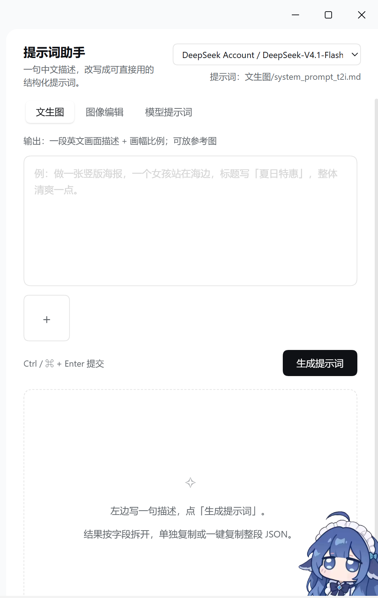
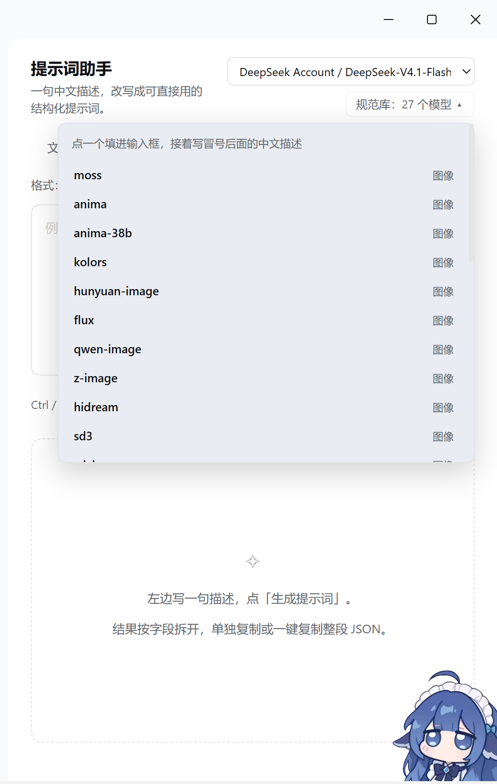

# dsh-prompt-assistant

[](LICENSE)

DeepSeek Harness（DSH）侧边栏里的**提示词助手**：一句话中文，出一个能直接用的提示词。

三个页签：

- **文生图** — 套用 `system_prompt_t2i.md`，输出英文画面描述 + 画幅比例（`rewritten_prompt` / `wh_ratio`）。
- **图像编辑** — 套用 `system_prompt_edit.md`，需要放要改的图，输出编辑指令 + 画幅（多图时带 `ratio_follow`）。
- **模型提示词** — 按 `模型名: 中文描述` 的格式（`moss: …`、`anima：…`、`h3: …`），用该模型的原生语法写英文提示词，并附中文直译；本地没收录的模型会联网查，查到后缓存。

三个页签都能放参考图；出结果后还能在面板底部继续对话调整。



模型规范库可以展开，点一个模型名自动把 `别名: ` 填进输入框：



## 功能

- 3 个页签 + 对话调整（说「背景换成夜晚」「再短一点」「翻译改口语」，模型回一份完整的新结果并更新卡片；也能问问题）。
- 图像编辑的多图引用按 `<image1>(简短描述)` 的格式写（如 `<image1>(穿白裙的女孩)`、`<image2>(夜晚的城市街道)`），下游能直接看出每张图是什么。
- 拖拽 / 粘贴 / 点 `+` 传图；前端统一重编码成 PNG/JPEG（最长边 2048），WebP、超大图、MIME 不符都不会到上游才报错。
- 模型下拉会标出不支持图片的模型；带图提交时前后端都会拦。
- 新加了本地模型？点下拉右边的 `↻` 重新读取，不用重启（Host 侧缓存 30 秒，面板每次打开也会刷一次）。
- 模型提示词模式内置 **24 个模型 / 97 个别名**的规范（FLUX、Qwen-Image、Seedream、Midjourney、SDXL、Nano Banana、Veo、Kling、Wan、Runway…），模型名不区分大小写，半角/全角冒号都认。
- 没收录的模型：先搜官方指南，抓正文（宿主 fetch 被挡时直接抓），写进 `~/.dsh/prompt-assistant/specs/<model>.md`，下次直接命中。
- 装了 [`h3-prompt-writing`](https://github.com/MiniMax-AI/MiniMax-H3/tree/main/skills) skill 的话，`h3:` / `h3-ref:` 会自动用它的官方指南（T2VA/I2VA/FL2VA/L2VA 三段式、Ref2VA 六段式）。
- 草稿、参考图、上次结果、对话记录切面板不丢。

## 环境

- DSH 桌面版（Web UI）。开发时用的是 0.2.1-rc.x，插件 API 走 `ctx.llm` / `ctx.attachments` / `ctx.webServer`。
- 一个可用的模型。图像相关功能需要模型支持图片输入（`deepseek-flash` 实测可以）。

## 安装

这是 DSH 的一个 bundle（`package.json` 里 `dsh.bundle.patch` + `dsh.client`），不需要构建。

**方式一：插件管理界面**

1. 把仓库克隆或下载到本地，例如 `D:\plugins\dsh-prompt-assistant`。
2. DSH → 插件 → 添加插件 → 选目录（或「本地安装」），指向这个目录。
3. 侧边栏出现「提示词助手」。

**方式二：命令行**

```bash
dsh plugin --profile <profile-name> add link:/absolute/path/to/dsh-prompt-assistant
```

> 桌面版自己管理的 profile 可能会拒绝命令行写入（`profile "…" is managed exclusively by the Electron application`），这种情况用方式一。

装好后如果改了 `index.js`（Host 半），浏览器不会自动换新代码：在插件页把这个 bundle 关掉再打开，或者重启 DSH。

## 配置

所有配置都在 bundle 的 `cordis.patch.yml` 里，`config` 下覆盖即可：

```yaml
- insert:
    - id: prompt-assistant
      name: dsh-prompt-assistant
      config:
        promptDir: 'D:\my-prompts'      # 你的 文生图/ 图像编辑/ 目录
        specDir: 'D:\my-specs'          # 自己的模型规范库
        learnedDir: 'D:\my-specs-learned'
```

| 键 | 默认 | 说明 |
|---|---|---|
| `promptDir` | `~/.dsh/prompt-assistant/prompts` | 下面放 `文生图/system_prompt_t2i.md`、`图像编辑/system_prompt_edit.md`；找不到就用包内 `prompts/` |
| `specDir` | `~/.dsh/skills/model-prompt-en/references` | 模型规范库（带 `index.md` 和 `models/`） |
| `specFallbackDir` | 包内 `specs/` | 上面找不到时用这个 |
| `learnedDir` | `~/.dsh/prompt-assistant/specs` | 联网学到的模型规范存这里 |
| `specFiles` | h3 的两个路径 | 直接挂外部文件当规范；文件不存在自动跳过 |
| `maxImages` / `maxImageBytes` / `maxBodyBytes` | `0`（不限）/ 12MB / 256MB | 图片张数、单张、请求体上限 |
| `webLookup` | `true` | 未收录模型是否联网查 |

## 本地接口

面板自己用，也可以脚本调（只接受回环 Host、同源请求，没有额外 token）：

```text
GET  /dsh-prompt-assistant/info
GET  /dsh-prompt-assistant/lookup?alias=moss
POST /dsh-prompt-assistant/rewrite   {mode, text, images?, model?}
POST /dsh-prompt-assistant/chat      {mode, input, result, history, text, model?}
```

## 数据与隐私

- 所有请求只走本机 DSH（默认 127.0.0.1），没有外部服务。
- 联网查模型规范时会把模型名发给搜索服务；抓到的正文缓存在本机。
- 学到的规范、草稿都只在你本机，不会上传。

## 已知限制

- 不做流式渲染：一次请求等模型返回完整 JSON。
- 对话调整只带文本结果，不会把参考图再发一遍。
- 模型不支持图片时面板会提示换模型；上游通道拒图时会把原始错误带出来。
- H3 的完整指南不随仓库分发（见 `NOTICE`）。

## License

[MIT](LICENSE)。两套系统提示词的来源与第三方文档的引用说明见 [NOTICE](NOTICE)。
